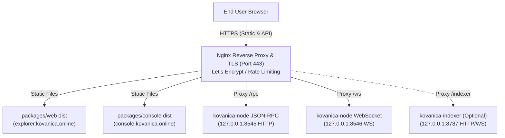

# Kovanica Block Explorer & Console Deployment Guide

> **Network ID:** `1` (`MAINNET`) / `4` (`TESTNET`)  
> **Native Ticker:** **KVNC** (9 decimals: $1\text{ KVNC} = 10^9\text{ atoms}$, legacy alias `KUNA`)  
> **Canonical Address Format:** PRO-21 base32 (`kvnc<57 base32>dag`, exactly 64 characters)  
> **Frontends Covered:** `packages/web` (Kovanica Block Explorer) and `packages/console` (Kovanica Node & Operator Console)  
> **Status:** Production Deployment & Operations Guide

---

## 1. Overview & Architecture

Kovanica ships with two dedicated TypeScript web applications designed for cluster inspection, node operations, wallet management, and blockchain exploration:

1. **Kovanica Block Explorer (`packages/web`):**
   - Public-facing block explorer for the Kovanica network.
   - Visualizes the MysticGhost DAG structure, committed leader blocks, transactions, validator committee stakes, contract execution logs, and account balances.
   - Hosted typically at `https://explorer.kovanica.online`.

2. **Kovanica Node Console (`packages/console`):**
   - Web application for node operators, developers, and power users.
   - Interfaces directly with local or remote Kovanica nodes for keystore management, offline transaction signing via `@kovanica/signer`, validator staking/delegation/unbonding operations, network sync inspection, and smart contract invocation.
   - Hosted typically at `https://console.kovanica.online`.

### 1.1 Ingress & Proxy Topology

In production, both applications are served as static Single-Page Applications (SPAs) behind an Nginx reverse proxy. The reverse proxy handles TLS termination, rate limiting, and forwards JSON-RPC and WebSocket traffic to the local `kovanica-node` backend daemon:



---

## 2. Building Production Bundles

Both web packages are built using Node.js, TypeScript, and Vite.

### 2.1 Prerequisites

- **Node.js:** Version `20.x` LTS or higher (`node -v`).
- **Package Manager:** `npm` version `9.x` or higher (`npm -v`).
- **Internal Dependencies:** The monorepo includes internal packages in `packages/`:
  - `packages/api-client`: Typed JSON-RPC 2.0 client (`@kovanica/api-client`).
  - `packages/signer`: Cryptographic transaction signer (`@kovanica/signer`).

### 2.2 Building the Block Explorer (`packages/web`)

1. Navigate to the explorer directory:
   ```bash
   cd packages/web
   ```

2. Install dependencies cleanly using `npm ci`:
   ```bash
   npm ci
   ```

3. Configure production environment variables (see Section 3 for configuration details):
   ```bash
   cp .env.example .env.production
   # Edit .env.production with target RPC and Chain ID
   ```

4. Build the optimized production bundle:
   ```bash
   npm run build
   ```
   *The build command runs `tsc && vite build`, compiling TypeScript declarations and bundling assets into `packages/web/dist/`.*

5. Verify build artifacts:
   ```bash
   ls -la dist/
   # Output should contain index.html, assets/*.js, assets/*.css, kuna-logo-128.png
   ```

### 2.3 Building the Console (`packages/console`)

1. Navigate to the console directory:
   ```bash
   cd packages/console
   ```

2. Install dependencies cleanly using `npm ci`:
   ```bash
   npm ci
   ```

3. Build the optimized production bundle:
   ```bash
   npm run build
   ```
   *The build command executes `tsc --noEmit && vite build`, bundling assets into `packages/console/dist/`.*

4. Verify build artifacts:
   ```bash
   ls -la dist/
   ```

---

## 3. Environment Configuration

Vite statically inlines environment variables prefixed with `VITE_` during build time (`import.meta.env`). Consequently, environment variables must be populated **prior** to running `npm run build`.

### 3.1 Environment Variable Reference

| Variable | Description | Explorer Default | Console Default | Mainnet Production Example |
|---|---|---|---|---|
| `VITE_RPC_URL` | JSON-RPC HTTP endpoint URL | `https://rpc-testnet.kovanica.online` | Hardcoded multi-network | `https://rpc.kovanica.online/rpc` (or `/rpc`) |
| `VITE_WS_URL` | JSON-RPC WebSocket endpoint URL | (Derived from RPC URL) | Hardcoded multi-network | `wss://rpc.kovanica.online/ws` (or `/ws`) |
| `VITE_CHAIN_ID` | Network Chain ID (`1` = Mainnet, `4` = Testnet v2, `1337` = Local) | `4` | `1` (Mainnet) | `1` |
| `VITE_INDEXER_HTTP_URL`| Optional kovanica-indexer HTTP base URL | `http://127.0.0.1:8787` | `null` | `https://indexer.kovanica.online` |
| `VITE_INDEXER_WS_URL` | Optional kovanica-indexer WebSocket URL | `ws://127.0.0.1:8787/ws` | `null` | `wss://indexer.kovanica.online/ws` |

### 3.2 Production Configuration Files

#### `packages/web/.env.production` (Mainnet Explorer)
```ini
# Production RPC Endpoint
VITE_RPC_URL=https://rpc.kovanica.online/rpc
VITE_WS_URL=wss://rpc.kovanica.online/ws

# Mainnet Chain ID (Strictly 1)
VITE_CHAIN_ID=1

# Optional Indexer Service (Leave unset to disable indexer tabs)
VITE_INDEXER_HTTP_URL=https://indexer.kovanica.online
VITE_INDEXER_WS_URL=wss://indexer.kovanica.online/ws
```

#### `packages/console/.env.production` (Console)
```ini
# Optional Indexer URLs for transaction indexing in Console
VITE_INDEXER_HTTP_URL=https://indexer.kovanica.online
VITE_INDEXER_WS_URL=wss://indexer.kovanica.online/ws
```

> [!NOTE]
> In `packages/console`, network definitions (Mainnet, Testnet, Local) are declared in `packages/console/src/network.ts`. For Mainnet production deployment, ensure `MAINNET.enabled = true` is set when opening the console to public mainnet transactions.

---

## 4. Nginx Reverse Proxy & TLS Configuration

A high-performance, battle-tested Nginx reverse proxy configuration serves the static web assets, provides TLS termination via Let's Encrypt, and proxies JSON-RPC HTTP (`:8545`) and WebSocket (`:8546`) requests to the backend node.

### 4.1 Nginx Site Configuration (`/etc/nginx/sites-available/kovanica.conf`)

Create or update the configuration file:

```nginx
# Upstream definitions for backend Kovanica node
upstream kovanica_rpc_http {
    server 127.0.0.1:8545;
    keepalive 64;
}

upstream kovanica_rpc_ws {
    server 127.0.0.1:8546;
    keepalive 64;
}

# Rate limiting zones
# 1. General RPC queries (30 requests/sec per IP)
limit_req_zone $binary_remote_addr zone=rpc_general_limit:10m rate=30r/s;
# 2. Write / transaction broadcast methods (5 requests/sec per IP)
limit_req_zone $binary_remote_addr zone=rpc_write_limit:10m rate=5r/s;

# Connection upgrade mapping for WebSockets
map $http_upgrade $connection_upgrade {
    default upgrade;
    ''      close;
}

# -------------------------------------------------------------
# 1. HTTP to HTTPS Redirection
# -------------------------------------------------------------
server {
    listen 80;
    listen [::]:80;
    server_name explorer.kovanica.online console.kovanica.online rpc.kovanica.online;

    location /.well-known/acme-challenge/ {
        root /var/www/certbot;
    }

    location / {
        return 301 https://$host$request_uri;
    }
}

# -------------------------------------------------------------
# 2. Kovanica Block Explorer (explorer.kovanica.online)
# -------------------------------------------------------------
server {
    listen 443 ssl http2;
    listen [::]:443 ssl http2;
    server_name explorer.kovanica.online;

    # SSL Certificates (managed by Certbot)
    ssl_certificate /etc/letsencrypt/live/explorer.kovanica.online/fullchain.pem;
    ssl_certificate_key /etc/letsencrypt/live/explorer.kovanica.online/privkey.pem;
    include /etc/letsencrypt/options-ssl-nginx.conf;
    ssl_dhparam /etc/letsencrypt/ssl-dhparams.pem;

    root /var/www/kovanica-web/dist;
    index index.html;

    # Security Headers
    add_header X-Frame-Options "SAMEORIGIN" always;
    add_header X-Content-Type-Options "nosniff" always;
    add_header X-XSS-Protection "1; mode=block" always;
    add_header Referrer-Policy "strict-origin-when-cross-origin" always;
    add_header Content-Security-Policy "default-src 'self'; script-src 'self'; style-src 'self' 'unsafe-inline'; img-src 'self' data: https:; connect-src 'self' https://rpc.kovanica.online wss://rpc.kovanica.online https://indexer.kovanica.online wss://indexer.kovanica.online; font-src 'self'; frame-ancestors 'self';" always;
    add_header Strict-Transport-Security "max-age=63072000; includeSubDomains; preload" always;

    # Immutable caching for hashed static assets
    location /assets/ {
        expires 1y;
        add_header Cache-Control "public, max-age=31536000, immutable";
        access_log off;
    }

    # SPA routing fallback
    location / {
        try_files $uri $uri/ /index.html;
        expires -1;
        add_header Cache-Control "no-cache, no-store, must-revalidate";
    }

    # Reverse proxy for local RPC path (if fronted under same origin)
    location /rpc {
        limit_req zone=rpc_general_limit burst=50 nodelay;
        limit_req_status 429;

        proxy_pass http://kovanica_rpc_http;
        proxy_http_version 1.1;
        proxy_set_header Connection "";
        proxy_set_header Host $host;
        proxy_set_header X-Real-IP $remote_addr;
        proxy_set_header X-Forwarded-For $proxy_add_x_forwarded_for;
        proxy_set_header X-Forwarded-Proto $scheme;
    }

    location /ws {
        proxy_pass http://kovanica_rpc_ws;
        proxy_http_version 1.1;
        proxy_set_header Upgrade $http_upgrade;
        proxy_set_header Connection $connection_upgrade;
        proxy_set_header Host $host;
        proxy_set_header X-Real-IP $remote_addr;
        proxy_set_header X-Forwarded-For $proxy_add_x_forwarded_for;
        proxy_read_timeout 86400s;
        proxy_send_timeout 86400s;
    }
}

# -------------------------------------------------------------
# 3. Kovanica Node Console (console.kovanica.online)
# -------------------------------------------------------------
server {
    listen 443 ssl http2;
    listen [::]:443 ssl http2;
    server_name console.kovanica.online;

    ssl_certificate /etc/letsencrypt/live/console.kovanica.online/fullchain.pem;
    ssl_certificate_key /etc/letsencrypt/live/console.kovanica.online/privkey.pem;
    include /etc/letsencrypt/options-ssl-nginx.conf;
    ssl_dhparam /etc/letsencrypt/ssl-dhparams.pem;

    root /var/www/kovanica-console/dist;
    index index.html;

    # Security Headers
    add_header X-Frame-Options "SAMEORIGIN" always;
    add_header X-Content-Type-Options "nosniff" always;
    add_header Referrer-Policy "strict-origin-when-cross-origin" always;
    add_header Content-Security-Policy "default-src 'self'; script-src 'self'; style-src 'self' 'unsafe-inline'; img-src 'self' data: https:; connect-src 'self' https://rpc.kovanica.online wss://rpc.kovanica.online https://rpc-testnet.kovanica.online wss://rpc-testnet.kovanica.online; font-src 'self';" always;

    location /assets/ {
        expires 1y;
        add_header Cache-Control "public, max-age=31536000, immutable";
        access_log off;
    }

    location / {
        try_files $uri $uri/ /index.html;
        expires -1;
        add_header Cache-Control "no-cache, no-store, must-revalidate";
    }
}

# -------------------------------------------------------------
# 4. Public JSON-RPC Gateway (rpc.kovanica.online)
# -------------------------------------------------------------
server {
    listen 443 ssl http2;
    listen [::]:443 ssl http2;
    server_name rpc.kovanica.online;

    ssl_certificate /etc/letsencrypt/live/rpc.kovanica.online/fullchain.pem;
    ssl_certificate_key /etc/letsencrypt/live/rpc.kovanica.online/privkey.pem;
    include /etc/letsencrypt/options-ssl-nginx.conf;
    ssl_dhparam /etc/letsencrypt/ssl-dhparams.pem;

    # CORS Headers
    add_header 'Access-Control-Allow-Origin' '*' always;
    add_header 'Access-Control-Allow-Methods' 'GET, POST, OPTIONS' always;
    add_header 'Access-Control-Allow-Headers' 'DNT,User-Agent,X-Requested-With,If-Modified-Since,Cache-Control,Content-Type,Range,Authorization' always;

    # Preflight OPTIONS request handler
    if ($request_method = 'OPTIONS') {
        return 204;
    }

    # HTTP JSON-RPC endpoint
    location / {
        limit_req zone=rpc_general_limit burst=50 nodelay;
        limit_req_status 429;

        proxy_pass http://kovanica_rpc_http;
        proxy_http_version 1.1;
        proxy_set_header Connection "";
        proxy_set_header Host $host;
        proxy_set_header X-Real-IP $remote_addr;
        proxy_set_header X-Forwarded-For $proxy_add_x_forwarded_for;
        proxy_set_header X-Forwarded-Proto $scheme;

        # Timeouts
        proxy_connect_timeout 5s;
        proxy_read_timeout 15s;
        proxy_send_timeout 15s;
    }

    # WebSocket JSON-RPC endpoint
    location /ws {
        proxy_pass http://kovanica_rpc_ws;
        proxy_http_version 1.1;
        proxy_set_header Upgrade $http_upgrade;
        proxy_set_header Connection $connection_upgrade;
        proxy_set_header Host $host;
        proxy_set_header X-Real-IP $remote_addr;
        proxy_set_header X-Forwarded-For $proxy_add_x_forwarded_for;
        proxy_read_timeout 86400s;
        proxy_send_timeout 86400s;
    }
}
```

### 4.2 Automated TLS Certificate Issuance (Let's Encrypt / Certbot)

1. Install Certbot and the Nginx plugin:
   ```bash
   apt-get update
   apt-get install -y certbot python3-certbot-nginx
   ```

2. Request certificates for the domains:
   ```bash
   certbot --nginx \
       -d explorer.kovanica.online \
       -d console.kovanica.online \
       -d rpc.kovanica.online \
       --agree-tos \
       --no-eff-email \
       -m ops@kovanica.online
   ```

3. Test automated certificate renewal:
   ```bash
   certbot renew --dry-run
   ```

---

## 5. Rate Limiting, Caching & Performance Tuning

Exposing a public blockchain RPC endpoint requires robust rate limiting to guard against Denial-of-Service attacks while maintaining low latency for legitimate explorer queries.

### 5.1 Rate Limiting Architecture

1. **General RPC Rate Limit:**
   - 30 requests per second per IP (`rate=30r/s`), with a burst allowance of 50 (`burst=50 nodelay`).
   - Applies to read queries: `kovanica_blockNumber`, `kovanica_getBlockByHash`, `kovanica_syncStatus`, `kovanica_getBalance`.
2. **Write / Heavy RPC Rate Limit:**
   - 5 requests per second per IP (`rate=5r/s`), with a burst allowance of 10 (`burst=10 nodelay`).
   - Applies to transaction broadcast: `kovanica_sendTransaction`, contract dry-runs.
3. **HTTP 429 Status Response:**
   - When requests exceed the burst limit, Nginx immediately returns `HTTP 429 Too Many Requests` without touching the backend node.
4. **Whitelisted IPs:**
   - Localhost (`127.0.0.1`), internal monitoring nodes, and indexers should be exempted using an Nginx `geo` block:
   ```nginx
   geo $limit {
       default 1;
       127.0.0.1/32 0;
       10.0.0.0/8 0;
   }
   map $limit $limit_key {
       0 "";
       1 $binary_remote_addr;
   }
   limit_req_zone $limit_key zone=rpc_general_limit:10m rate=30r/s;
   ```

### 5.2 Browser & Proxy Caching Policies

| Endpoint / Asset | Cache Directive | Max-Age | Rationale |
|---|---|---|---|
| `/assets/*.js`, `/assets/*.css` | `public, max-age=31536000, immutable` | 1 Year | Hashed bundle filenames change on every build. |
| `/index.html` | `no-cache, no-store, must-revalidate` | 0 Seconds | Guarantees users immediately receive new SPA release versions. |
| `/kuna-logo-128.png`, `/favicon.ico` | `public, max-age=86400` | 24 Hours | Static branding assets. |
| `/rpc` (Finalized Block / Receipt Queries) | Optional micro-cache: `max-age=5` | 5 Seconds | Finalized blocks are immutable; relieves database read load. |
| `/rpc` (Mempool / Head Queries) | `no-store` | 0 Seconds | Must always return real-time head state. |

---

## 6. Dedicated Query Node Setup

For production explorer hosting, run a dedicated query node separated from the consensus validator committee:

### 6.1 Query Node Configuration (`/etc/kovanica/config-query.toml`)

```toml
chain_id = 1
data_dir = "/var/lib/kovanica/data"
listen_addr = "0.0.0.0:8000"

# Bind RPC to localhost for Nginx reverse proxy
rpc_addr = "127.0.0.1"
rpc_port = 8545
max_peers = 100

# Do NOT participate in validator consensus
run_validator = false

# Internal rate limit (Nginx handles public rate limits)
rpc_rate_limit_per_min = 3600

# Canonical mainnet seed multiaddrs
bootnodes = [
    "/dns4/seed1.kovanica.online/tcp/8000/p2p/12D3KooW...",
    "/dns4/seed2.kovanica.online/tcp/8000/p2p/12D3KooW...",
    "/dns4/seed3.kovanica.online/tcp/8000/p2p/12D3KooW..."
]
```

### 6.2 Systemd Unit File (`/etc/systemd/system/kovanica-query-node.service`)

```ini
[Unit]
Description=Kovanica Dedicated Query Node
After=network.target

[Service]
Type=simple
User=kovanica
Group=kovanica
WorkingDirectory=/var/lib/kovanica
ExecStart=/usr/local/bin/kovanica-node --config /etc/kovanica/config-query.toml
Restart=always
RestartSec=5
LimitNOFILE=65535

# Environment Hardening
NoNewPrivileges=true
ProtectSystem=full
ProtectHome=true

[Install]
WantedBy=multi-user.target
```

---

## 7. Deployment Automation & Operations Runbook

### 7.1 Automated Deployment Script (`scripts/deploy-explorer.sh`)

A production deployment script automates compiling frontends and deploying to `/var/www`:

```bash
#!/usr/bin/env bash
set -euo pipefail

REPO_DIR="/root/Projects/kovanica-wt-freeze"
WEB_DEST="/var/www/kovanica-web"
CONSOLE_DEST="/var/www/kovanica-console"

echo "=== Deploying Kovanica Explorer & Console ==="

# 1. Build packages/web
echo "Building packages/web..."
cd "${REPO_DIR}/packages/web"
npm ci
VITE_RPC_URL="https://rpc.kovanica.online/rpc" \
VITE_WS_URL="wss://rpc.kovanica.online/ws" \
VITE_CHAIN_ID="1" \
npm run build

# 2. Build packages/console
echo "Building packages/console..."
cd "${REPO_DIR}/packages/console"
npm ci
npm run build

# 3. Deploy to web root
echo "Syncing bundles to web roots..."
mkdir -p "${WEB_DEST}" "${CONSOLE_DEST}"
rsync -av --delete "${REPO_DIR}/packages/web/dist/" "${WEB_DEST}/dist/"
rsync -av --delete "${REPO_DIR}/packages/console/dist/" "${CONSOLE_DEST}/dist/"

# 4. Set permissions
chown -R www-data:www-data "${WEB_DEST}" "${CONSOLE_DEST}"

# 5. Reload Nginx
echo "Testing Nginx configuration and reloading..."
nginx -t
systemctl reload nginx

echo "=== Deployment Complete ==="
```

### 7.2 Verification & Health Checks

Run post-deployment diagnostics to confirm operational health:

```bash
# 1. Verify static asset serving
curl -I https://explorer.kovanica.online
curl -I https://console.kovanica.online

# 2. Test JSON-RPC via reverse proxy
curl -fsS -X POST https://rpc.kovanica.online \
  -H "Content-Type: application/json" \
  -d '{"jsonrpc":"2.0","method":"kovanica_blockNumber","params":[],"id":1}' | jq .

# 3. Test WebSocket connection
websocat -n1 wss://rpc.kovanica.online/ws <<< '{"jsonrpc":"2.0","method":"kovanica_blockNumber","params":[],"id":1}'

# 4. Test rate-limiting enforcement
for i in {1..40}; do
  curl -s -o /dev/null -w "%{http_code}\n" https://rpc.kovanica.online
done | grep -c "429"
```

### 7.3 Troubleshooting Common Issues

1. **HTTP 502 Bad Gateway:**
   - Check if the backend query node is running: `systemctl status kovanica-query-node`.
   - Verify node is listening on port 8545: `ss -tulpn | grep 8545`.
   - Inspect node logs: `journalctl -u kovanica-query-node -n 50 --no-pager`.
2. **WebSocket Connection Closed Immediately:**
   - Verify that the `proxy_set_header Upgrade` and `proxy_set_header Connection` directives are set in Nginx.
   - Ensure the backend node port 8546 is responsive: `nc -zvw3 127.0.0.1 8546`.
3. **CORS Blockage in Browser:**
   - Confirm Nginx includes `Access-Control-Allow-Origin: *` on `rpc.kovanica.online`.
   - Check that preflight `OPTIONS` requests return `HTTP 204`.
4. **Blank Page on Deep Link / Page Refresh:**
   - Ensure `try_files $uri $uri/ /index.html;` is present in the Nginx `location /` block.
