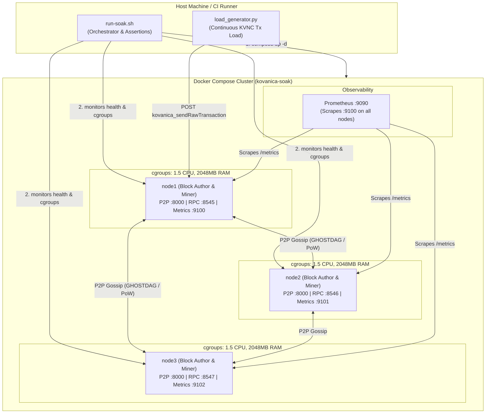

# Kovanica Long-Running Soak & Resource Budget Test Harness

Automated multi-node containerized soak testing orchestration with strict cgroup resource budgets, continuous transaction load generation, and validation scripts under `ops/soak/`.

## Architecture Overview



### Components

| Component | Path | Description |
|-----------|------|-------------|
| **Orchestrator** | `ops/soak/run-soak.sh` | Main test runner; brings up stack, runs warmup, monitors cgroup & height metrics, runs assertions, collects diagnostics. |
| **Load Generator** | `ops/soak/load_generator.py` | Python load generator; signs and submits valid KVNC transfers via JSON-RPC, reports TPS and latency statistics. |
| **Compose Stack** | `ops/soak/docker-compose.soak.yml` | 3 block-authoring nodes with strict cgroup limits (`cpus: 1.5`, `mem_limit: 2048m`) and Prometheus scraper. |
| **Scraper Config** | `ops/soak/prometheus.soak.yml` | Prometheus configuration scraping all 3 nodes on port 9100. |
| **Funded Accounts** | `ops/soak/funded_accounts.toml` | Pre-funded genesis accounts for soak load generation (100,000 KVNC each). |

---

## Resource Budget & Rules

In compliance with `AGENTS.md`:
* **Target Environment**: VPS friendly, 2–4 GB RAM, 2 CPU cores.
* **Cgroup Constraints**: Configured per node container:
  * `cpus: '1.5'`
  * `mem_limit: 2048m` (2 GiB)
* **Default Network Ports**:
  * P2P: `8000`
  * JSON-RPC: `8545` (node1), `8546` (node2), `8547` (node3)
  * Prometheus Metrics: `9100` (node1), `9101` (node2), `9102` (node3)
* **Currency & Address**: Native token is **KVNC** (9 decimals, 1 KVNC = $10^9$ atoms). Address format is canonical PRO-21 base32 (`kvnc...dag`, 64 characters).

---

## Prerequisites

1. **Docker & Compose**: Docker Engine >= 24.0 and Docker Compose v2.
2. **Python 3**: Python >= 3.9 with `cryptography` package (`apt install python3-cryptography` or `pip install cryptography`).
3. **Core Utilities**: `bash`, `curl`, `jq`, `awk`.
4. **Node Docker Image**: Built locally with `docker build -t kovanica-node:local .` or built automatically by docker compose.

---

## Running Soak Tests

### 1. 10-Minute Smoke Soak (CI / Local Verification)

Fast regression test verifying stack boot, peer mesh formation, transaction ingestion, and clean teardown:

```bash
./ops/soak/run-soak.sh --duration 10m
```
*(Alternative syntax: `./ops/soak/run-soak.sh --duration 600`)*

### 2. 6-Hour Endurance Soak

Validates memory stabilization, absence of slow RSS memory leaks, and sustained consensus:

```bash
./ops/soak/run-soak.sh --duration 6h --interval 30 --rate 5.0 --out-dir /tmp/soak-6h
```

### 3. 24-Hour Production Long Soak

The comprehensive production qualification soak testing memory stability under 2048MB cgroup limits, DAG growth, and sustained transaction throughput:

```bash
./ops/soak/run-soak.sh --duration 24h --interval 60 --rate 10.0 --out-dir /var/log/kovanica-soak-24h
```

### 4. Running Standalone Load Generator

You can also run the load generator against an already running node or cluster:

```bash
python3 ops/soak/load_generator.py \
  --rpc-url http://127.0.0.1:8545 \
  --chain-id 2 \
  --duration 300 \
  --rate 10.0 \
  --out-json /tmp/load_stats.json
```

---

## Automated Assertions

`run-soak.sh` enforces the following critical gates:

1. **Zero OOM Kills (`oom_killed == false`)**:
   Monitored every sample interval and verified on teardown across all containers via Docker inspect:
   ```bash
   docker inspect -f '{{.State.OOMKilled}}' <container_id> == false
   ```
2. **Monotonic Height Increase**:
   Block heights on all 3 nodes are tracked continuously. The test fails immediately if:
   * Any node's block height decreases ($\text{height}_t < \text{height}_{t-1}$).
   * Any node fails to advance within `--stall` seconds (default 120s).
   * Any node's final height does not exceed its initial height.
3. **Container Liveness & HTTP Health**:
   All nodes must maintain `HTTP 200` with `status: "ok"` on `/health`. Any container crash, exit, or degraded status triggers an immediate failure.
4. **Clean Cluster Shutdown**:
   Upon test completion or interruption, background processes are terminated and Docker Compose cleanly tears down volumes and networks (unless `--no-teardown` is passed).

---

## Artifacts & Logs

All diagnostics are written to `--out-dir` (default `${TMPDIR:-/tmp}/kovanica-soak`):

* `soak.log`: Full execution log with timestamps.
* `samples.csv`: Time-series samples of timestamp, elapsed seconds, node, status, peer count, block height, mempool size, memory RSS, memory limit, CPU %, and OOM status.
* `load_generator.log`: Output from the transaction load generator.
* `load_generator_stats.json`: Detailed latency distribution and throughput summary.
* `compose-ps.txt`, `compose-logs.txt`, `docker-stats.txt`: Container diagnostics and logs.
* `inspect-<node>.json`: Full `docker inspect` JSON snapshots for post-mortem analysis.

---

## Prometheus & Grafana Observability

### Prometheus Metrics Scraped on Port 9100

Prometheus runs on `http://127.0.0.1:9090` scraping all nodes on port `9100`. Key metrics:

| Metric | Type | Meaning | Expected Soak Behavior |
|--------|------|---------|------------------------|
| `block_height` | Gauge | Monotonically advancing chain height | Continuously increasing (~4s per block) |
| `ghostdag_blue_blocks` | Counter | GHOSTDAG sequenced blue blocks | Steadily increases with DAG progression |
| `pow_blocks_mined` | Counter | PoW blocks mined per node | Distributed across author 0, 1, and 2 |
| `mempool_size` | Gauge | Uncommitted transactions in mempool | Fluctuate with load generator bursts, drains cleanly |
| `rss_proxy` | Gauge | Memory usage proxy | Bounded well within 2048MB limit |

### Prometheus Query Examples

* **Block Height Velocity (blocks/minute)**:
  ```promql
  rate(block_height[5m]) * 60
  ```
* **Mempool Size across Nodes**:
  ```promql
  mempool_size{job="kovanica-soak"}
  ```
* **PoW Mining Hash Rate / Block Production**:
  ```promql
  rate(pow_blocks_mined[5m])
  ```

### Grafana Dashboard Integration

To visualize soak metrics in Grafana:
1. Connect Grafana datasource to Prometheus at `http://127.0.0.1:9090`.
2. Import dashboard definitions from `ops/docker/grafana/dashboards/`.
3. Observability alert rules from `ops/prometheus/alerts.yml` apply directly to the soak cluster.
